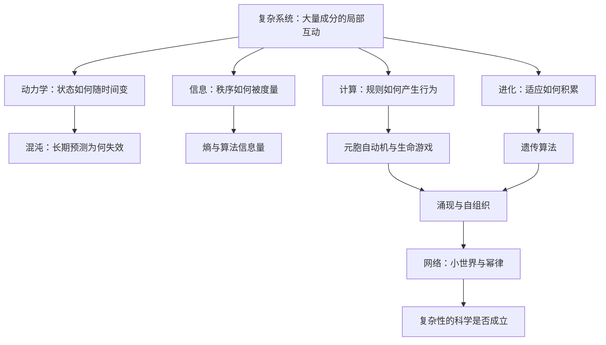

# 复杂 点化学习系统

## 这本书在讲什么

这本书回答一个问题：蚂蚁、大脑、免疫系统、经济、万维网这些八竿子打不着的系统，为什么会长得像亲戚。米歇尔的论证主线是：它们都由大量简单成分局部互动，在没有中央指挥的情况下涌现出宏观秩序，并通过信息处理与适应把秩序维持下去。她一边介绍动力学、信息、计算、进化、网络这几套工具，一边不断追问：这些共性是真规律，还是同一个比喻被重复使用。全书最后落在复杂性科学到底做出了什么、还差什么。

## 全书心智模型

## 学习路径（推荐顺序）

| 步骤 | 章节 | 主题 | 前置 | 检查点 |
|---|---|---|---|---|
| 01 | ch01 | 复杂性是什么 | 无 | 完成本章自测 ≥2 题 |
| 02 | ch02 | 动力学、混沌和预测 | ch01；会做函数迭代 | 完成本章自测 ≥2 题 |
| 03 | ch03 | 信息 | ch02；对数 | 完成本章自测 ≥2 题 |
| 04 | ch04 | 计算 | ch03；基本逻辑 | 完成本章自测 ≥2 题 |
| 05 | ch05 | 进化 | ch01 | 完成本章自测 ≥2 题 |
| 06 | ch06 | 遗传学概要 | ch05 | 完成本章自测 ≥2 题 |
| 07 | ch07 | 度量复杂性 | ch03、ch04 | 完成本章自测 ≥2 题 |
| 08 | ch08 | 自我复制的计算机程序 | ch04、ch06 | 完成本章自测 ≥2 题 |
| 09 | ch09 | 遗传算法 | ch05、ch08 | 完成本章自测 ≥2 题 |
| 10 | ch10 | 元胞自动机、生命和宇宙 | ch04 | 完成本章自测 ≥2 题 |
| 11 | ch11 | 粒子计算 | ch10 | 完成本章自测 ≥2 题 |
| 12 | ch12 | 生命系统中的信息处理 | ch11 | 完成本章自测 ≥2 题 |
| 13 | ch13 | 如何进行类比（如果你是计算机） | ch12 | 完成本章自测 ≥2 题 |
| 14 | ch14 | 计算机模型 | ch09、ch13 | 完成本章自测 ≥2 题 |
| 15 | ch15 | 网络科学 | ch14 | 完成本章自测 ≥2 题 |
| 16 | ch16 | 真实世界中的网络 | ch15 | 完成本章自测 ≥2 题 |
| 17 | ch17 | 比例之谜 | ch15 | 完成本章自测 ≥2 题 |
| 18 | ch18 | 进化，复杂化 | ch05、ch07 | 完成本章自测 ≥2 题 |
| 19 | ch19 | 复杂性科学的过去和未来 | 全书 | 完成本章自测 ≥2 题 |

## 章节索引

- 第 1 章 复杂性是什么（难度 ★）→ chapters/ch01-复杂性是什么.md
- 第 2 章 动力学、混沌和预测（难度 ★★）→ chapters/ch02-动力学-混沌和预测.md
- 第 3 章 信息（难度 ★★）→ chapters/ch03-信息.md
- 第 4 章 计算（难度 ★★）→ chapters/ch04-计算.md
- 第 5 章 进化（难度 ★）→ chapters/ch05-进化.md
- 第 6 章 遗传学概要（难度 ★★）→ chapters/ch06-遗传学概要.md
- 第 7 章 度量复杂性（难度 ★★★）→ chapters/ch07-度量复杂性.md
- 第 8 章 自我复制的计算机程序（难度 ★★）→ chapters/ch08-自我复制的计算机程序.md
- 第 9 章 遗传算法（难度 ★★）→ chapters/ch09-遗传算法.md
- 第 10 章 元胞自动机、生命和宇宙（难度 ★★）→ chapters/ch10-元胞自动机-生命和宇宙.md
- 第 11 章 粒子计算（难度 ★★★）→ chapters/ch11-粒子计算.md
- 第 12 章 生命系统中的信息处理（难度 ★★）→ chapters/ch12-生命系统中的信息处理.md
- 第 13 章 如何进行类比（如果你是计算机）（难度 ★★★）→ chapters/ch13-如何进行类比-如果你是计算机.md
- 第 14 章 计算机模型（难度 ★★）→ chapters/ch14-计算机模型.md
- 第 15 章 网络科学（难度 ★★）→ chapters/ch15-网络科学.md
- 第 16 章 真实世界中的网络（难度 ★★）→ chapters/ch16-真实世界中的网络.md
- 第 17 章 比例之谜（难度 ★★★）→ chapters/ch17-比例之谜.md
- 第 18 章 进化，复杂化（难度 ★★★）→ chapters/ch18-进化-复杂化.md
- 第 19 章 复杂性科学的过去和未来（难度 ★★）→ chapters/ch19-复杂性科学的过去和未来.md

## 前置知识（零基础缺口补讲）

| 缺口 | 对应补讲位置 | 学完标志 |
|---|---|---|
| 概率与随机性（“随机”不等于“均匀”） | ch09、ch14 讲解中就地补讲 | 能算出一次随机选择带来的期望得分 |
| 函数与迭代（把上一步结果代回公式） | ch02 概念 2 展开 | 能手算 5 步 logistic 映射 |
| 对数的含义 | ch03 概念 2 展开 | 能说明为什么 log 能把乘法变加法 |
| 自然选择的三要素 | ch05 概念 1 展开 | 能说出变异、遗传、选择压力各指什么 |

## 术语表 / 模式库 / 速查表 入口

- 术语：[glossary.md](glossary.md)
- 模式与框架：[patterns.md](patterns.md)
- 速查：[cheatsheet.md](cheatsheet.md)
- 测验：[quiz.md](quiz.md)
- 抽认卡：[flashcards.md](flashcards.md)

> 单书伴侣：`complex学习伴侣.html`（双击即可离线学习）
