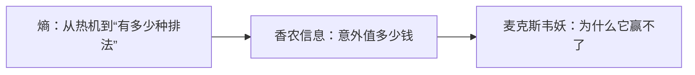

# 第 3 章：信息

- **难度**：★★☆ ｜ **预估学时**：1.5 小时 ｜ **前置**：ch02；对数

## 学习目标

- 能用“意外程度”解释香农信息量，并算出简单情形的比特数
- 能说清麦克斯韦妖为什么不能违反热力学第二定律

## 一句话核心

信息是“不确定性的减少”：一件事越难猜，它发生时所含的信息越多；熵是这种不确定性的度量，因此信息与热力学熵是同一个数学量在两套语境下的名字。

## 零基础讲解

### 概念 1：熵：从热机到“有多少种排法”（难度：基础）

**熵**（entropy，白话：一个宏观状态对应多少种微观排法）在统计力学里由玻尔兹曼给出：S = k·log W，W 是微观状态数。一盘整齐排列的分子只有一种排法，熵低；打散之后排法无数，熵高。系统自发从低熵走向高熵，不是因为“喜欢乱”，而是因为高熵的排法数量压倒性地多，随机走一步几乎必然走进高熵那一边。

### 概念 2：香农信息：意外值多少钱（难度：进阶）

**香农信息**（Shannon information，白话：收到消息后不确定性减少了多少）把“信息量”定义成 −log₂ p。抛一枚均匀硬币，结果 p=0.5，信息量 1 比特；如果硬币两面都是正面，p=1，信息量 0——你早就知道，它没带来任何新东西。一串序列的总信息量是所有符号信息量之和。这里有个反直觉的结论：完全随机的序列信息量最大，但它是无意义的；有意义的信息恰恰是“有规律因而可压缩”的那部分。

### 概念 3：麦克斯韦妖：为什么它赢不了（难度：高难）

设想一个小妖守着隔板上的小门，看到快分子就放去左边、慢分子放去右边，于是左边变热、右边变冷，熵下降了。这个思想实验曾被当成第二定律的反例。解决的关键不在分子，而在妖：它必须**测量**分子的速度并**记住**结果，测量和存储信息本身要消耗能量、产生熵。把妖的记忆擦掉时付出的代价，正好抵消它制造的温差。信息不是免费的。

## 图示

看图说明：方框是本章的概念顺序，箭头表示后一个概念必须建立在前一个之上。读图时先确认每个方框你都说得出一句白话定义，再往下看。

## 类比与实例

- **类比**：信息量像“猜谜的难度”：一本你知道答案的书，翻开来什么也没告诉你。边界：这个类比只管“意外程度”，不管“意义”；一本书可能信息量很低却很深刻，香农熵不区分这两者。
- **实例**：猜一个 1 到 8 的整数，每次只能问是/否。均匀分布时最优策略是二分，3 个问题必中，总信息量 3 比特 = log₂8。若你事先知道答案是 5，则信息量为 0。若分布是“90% 是 5”，那么问“是 5 吗”一次就有 90% 命中，期望问题数小于 3——分布越偏，熵越低。

## 常见误解

- 别以为熵增是因为系统“趋向混乱”——实际上是高熵对应的微观排法更多，概率上占绝对多数。
- 别以为信息越多越好——实际上随机噪声信息量最大，却毫无用处。

## 自测题（答案）

1. 一枚两面相同的硬币抛一次，香农信息量是多少？
   - A. 0 比特
   - B. 0.5 比特
   - C. 1 比特
   - D. 2 比特
   - **答案**：A；**解析**：p=1，−log₂1=0：结果完全可预测，没有减少任何不确定性。
2. 麦克斯韦妖不能永久降低熵，关键原因是？
   - A. 分子太小抓不住
   - B. 测量与记忆、擦除记忆需要耗能产熵
   - C. 隔板不导热
   - D. 热力学第二定律只适用于宏观系统
   - **答案**：B；**解析**：兰道尔原理指出擦除 1 比特信息至少耗散 kT ln2 的能量，妖的账要一起算。

## 复习锚点

- 信息 = 不确定性的减少 = −log₂p
- 熵 = 微观排法数 = k log W
- 妖要测量和记忆，信息处理有热力学成本
