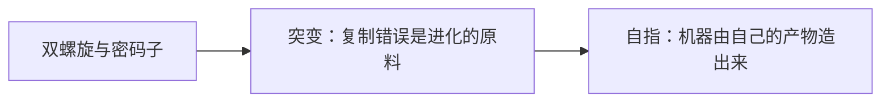

# 第 6 章：遗传学概要

- **难度**：★★☆ ｜ **预估学时**：0.8 小时 ｜ **前置**：ch05

## 学习目标

- 能说出 DNA→RNA→蛋白质的信息流，并指出其中哪一步有自指
- 能解释突变率为什么低却不为零

## 一句话核心

DNA 是可复制的程序，细胞是可执行它的机器；这套系统最特别的地方在于，执行程序的机器本身也是由程序编码出来的。

## 零基础讲解

### 概念 1：双螺旋与密码子（难度：基础）

1953 年沃森和克里克给出 DNA 双螺旋结构：两条链由碱基配对（A-T、G-C）连起来，可以解开各自复制。**转录**（transcription，白话：把 DNA 抄成 mRNA）之后，**翻译**（translation，白话：按三个碱基一个**密码子**查表装氨基酸）在核糖体上装配出蛋白质。20 世纪 60 年代密码表被破译，生物学第一次有了“通用字符集”。

### 概念 2：突变：复制错误是进化的原料（难度：基础）

复制不是完美的：碱基配对偶尔出错，大约每千亿个核苷酸出一次；还有插入、缺失、重复。绝大多数突变有害或中性，极少数有用，但进化只需要极少数。关键是突变率不能太高：太高则后代面目全非，积累不了优势；太低则适应太慢。进化调到了一个中间值。

### 概念 3：自指：机器由自己的产物造出来（难度：高难）

mRNA、tRNA、核糖体、聚合酶这些执行转录翻译的装置，本身也是 DNA 编码、由这套装置生产出来的。这是一个闭环：程序生产机器，机器执行程序。米歇尔在第 8 章会拿它和冯·诺依曼的自复制自动机对照——生命与计算在这里撞上了同一个结构难题。

## 图示

看图说明：方框是本章的概念顺序，箭头表示后一个概念必须建立在前一个之上。读图时先确认每个方框你都说得出一句白话定义，再往下看。

## 类比与实例

- **类比**：DNA 像一份既能复制自己、又能造出印刷机的图纸：印刷机印图纸，图纸造印刷机。边界：图纸不会自己行动，细胞里还有大量调控与代谢网络，不能简化成“DNA 决定一切”。
- **实例**：一个碱基替换（点突变）可能只改一个氨基酸，蛋白质照样工作；如果替换发生在关键活性位点，酶就失效。同一个错误，后果取决于位置——这就是为什么“突变有害”不能一概而论。

## 常见误解

- 别以为一个基因决定一个性状——实际上多数性状由多基因与环境共同决定。
- 别以为 DNA 就是“生命的全部程序”——实际上表观遗传、剪接、非编码 RNA 都在参与调控。

## 自测题（答案）

1. 中心法则的信息流顺序是？
   - A. 蛋白质→DNA→RNA
   - B. DNA→RNA→蛋白质
   - C. RNA→蛋白质→DNA
   - D. DNA→蛋白质→RNA
   - **答案**：B；**解析**：转录（DNA→RNA）与翻译（RNA→蛋白质）构成主流信息流。
2. 为什么突变率不能太高？
   - A. 会让细胞立刻死亡
   - B. 后代变化过大，无法稳定积累有利性状
   - C. 会增加能耗
   - D. 会破坏双螺旋结构
   - **答案**：B；**解析**：进化需要在“有变化”和“保住已有成果”之间取平衡。

## 复习锚点

- DNA→RNA→蛋白质
- 突变是原料，多数有害、少数有用
- 执行程序机器本身也被程序编码（自指）
