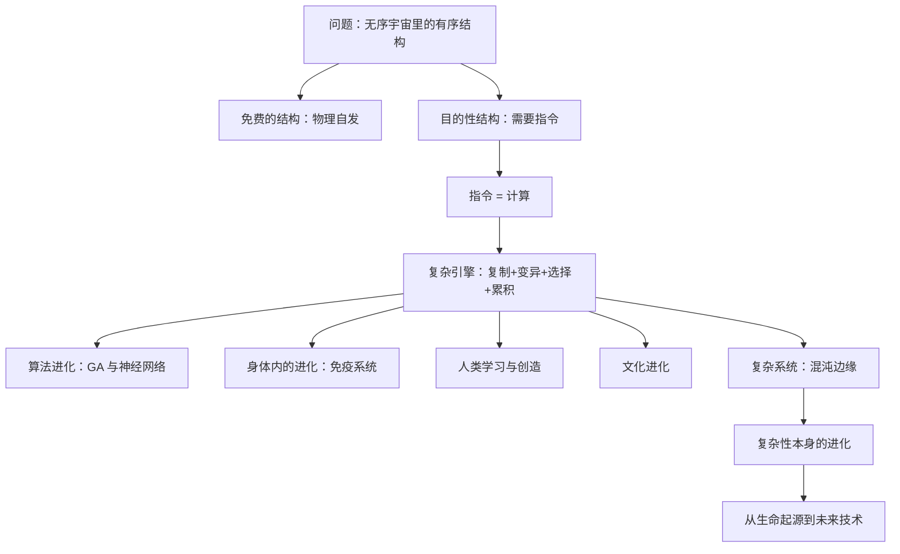

# 复杂的引擎 点化学习系统

## 这本书在讲什么

这本书要回答的是：宇宙整体在走向无序，为什么到处长出了有序、而且是有目的的结构。梅菲尔德的答案是“复杂引擎”——复制、变异、选择、累积四步循环。它是一台计算装置：不预设答案，只靠一代代筛选，把极不可能的结构变成几乎必然出现。书里先区分物理自发形成的结构（雪花、对流）与需要指令才能形成的目的性结构（螺丝刀、蛋白质），再把同一台引擎从分子、细胞、免疫、神经网络一路推到人类学习、文化、技术与未来。

## 全书心智模型

## 学习路径（推荐顺序）

| 步骤 | 章节 | 主题 | 前置 | 检查点 |
|---|---|---|---|---|
| 01 | ch01 | 第1章 问题 | 无 | 完成本章自测 ≥2 题 |
| 02 | ch02 | 第2章 计算 | ch01 | 完成本章自测 ≥2 题 |
| 03 | ch03 | 第3章 免费的结构 | ch01、ch02 | 完成本章自测 ≥2 题 |
| 04 | ch04 | 第4章 目的性结构 | ch03 | 完成本章自测 ≥2 题 |
| 05 | ch05 | 第5章 无概率性和复杂引擎 | ch02、ch04 | 完成本章自测 ≥2 题 |
| 06 | ch06 | 第6章 算法进化 | ch05 | 完成本章自测 ≥2 题 |
| 07 | ch07 | 第7章 身体内的进化 | ch05、ch06 | 完成本章自测 ≥2 题 |
| 08 | ch08 | 第8章 控制循环 | ch04 | 完成本章自测 ≥2 题 |
| 09 | ch09 | 第9章 复杂系统 | ch02 | 完成本章自测 ≥2 题 |
| 10 | ch10 | 第10章 人类学习和创造性 | ch06、ch09 | 完成本章自测 ≥2 题 |
| 11 | ch11 | 第11章 文化的进化 | ch05、ch10 | 完成本章自测 ≥2 题 |
| 12 | ch12 | 第12章 复杂性的进化 | ch05、ch09 | 完成本章自测 ≥2 题 |
| 13 | ch13 | 第13章 过去和现在 | ch05、ch07 | 完成本章自测 ≥2 题 |
| 14 | ch14 | 第14章 未来 | ch12、ch13 | 完成本章自测 ≥2 题 |

## 章节索引

- 第 1 章 第1章 问题（难度 ★）→ chapters/ch01-问题.md
- 第 2 章 第2章 计算（难度 ★★）→ chapters/ch02-计算.md
- 第 3 章 第3章 免费的结构（难度 ★★）→ chapters/ch03-免费的结构.md
- 第 4 章 第4章 目的性结构（难度 ★★）→ chapters/ch04-目的性结构.md
- 第 5 章 第5章 无概率性和复杂引擎（难度 ★★★）→ chapters/ch05-无概率性和复杂引擎.md
- 第 6 章 第6章 算法进化（难度 ★★）→ chapters/ch06-算法进化.md
- 第 7 章 第7章 身体内的进化（难度 ★★★）→ chapters/ch07-身体内的进化.md
- 第 8 章 第8章 控制循环（难度 ★★）→ chapters/ch08-控制循环.md
- 第 9 章 第9章 复杂系统（难度 ★★★）→ chapters/ch09-复杂系统.md
- 第 10 章 第10章 人类学习和创造性（难度 ★★★）→ chapters/ch10-人类学习和创造性.md
- 第 11 章 第11章 文化的进化（难度 ★★）→ chapters/ch11-文化的进化.md
- 第 12 章 第12章 复杂性的进化（难度 ★★★）→ chapters/ch12-复杂性的进化.md
- 第 13 章 第13章 过去和现在（难度 ★★★）→ chapters/ch13-过去和现在.md
- 第 14 章 第14章 未来（难度 ★★）→ chapters/ch14-未来.md

## 前置知识（零基础缺口补讲）

| 缺口 | 对应补讲位置 | 学完标志 |
|---|---|---|
| 什么是算法（有限步骤的机械过程） | ch02 概念 2 | 能把一个日常流程写成 5 步以内的指令序列 |
| 概率的基本直觉（组合数爆炸） | ch05 概念 1 | 能估算 100 个位置各两种选择的组合数 |
| DNA 与蛋白质的基本关系 | ch04 概念 2 | 能说出基因、mRNA、蛋白质三者的先后 |
| 网络与节点的概念 | ch09 概念 1 | 能画出 5 个节点的连接图并数出边数 |

## 术语表 / 模式库 / 速查表 入口

- 术语：[glossary.md](glossary.md)
- 模式与框架：[patterns.md](patterns.md)
- 速查：[cheatsheet.md](cheatsheet.md)
- 测验：[quiz.md](quiz.md)
- 抽认卡：[flashcards.md](flashcards.md)

> 单书伴侣：`engines-of-complexity学习伴侣.html`（双击即可离线学习）
