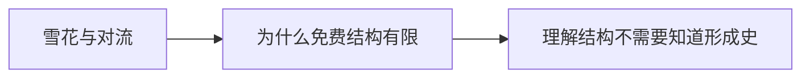

# 第 3 章：免费的结构

- **难度**：★★☆ ｜ **预估学时**：0.9 小时 ｜ **前置**：ch01、ch02

## 学习目标

- 能举三个物理自发结构的例子并说出其共同机制
- 能说明“不需要知道形成细节也能理解结构”的含义

## 一句话核心

物理系统在能量与对称性的约束下会自动形成有序结构，不需要任何指令；这类秩序是“免费”的，但它的形态种类有限。

## 零基础讲解

### 概念 1：雪花与对流（难度：基础）

雪花：水分子按氢键角度附着，六角对称由分子几何决定，每片雪花的细节不同但骨架相同。对流：底部受热的流体会形成规则六边形胞（贝纳德胞），因为这种对流模式最有效地输运热量。两者都不需要“设计”，只需要能量梯度与局部规则。

### 概念 2：为什么免费结构有限（难度：进阶）

免费结构的形态由物理常数与对称性决定，因此可复现、可预测，但种类不多——晶体、波纹、条纹、胞状结构，翻来覆去就这些。要得到螺丝刀这种“为了拧螺丝而存在”的形状，物理定律帮不上忙：能量最低态不会自己变成工具。

### 概念 3：理解结构不需要知道形成史（难度：进阶）

梅菲尔德指出：理解一个结构，只需知道它**可能的**形成途径，不必知道具体哪一次怎么形成。这和“读懂一句外语”类似——你不需要知道说话人今天的经历，也能理解句子。

## 图示

看图说明：方框是本章的概念顺序，箭头表示后一个概念必须建立在前一个之上。读图时先确认每个方框你都说得出一句白话定义，再往下看。

## 类比与实例

- **类比**：水烧开时的对流花纹像一支不用指挥的合唱团：每个人只按身边的温度行动，最后自动排出队形。边界：合唱团的队形由物理约束决定，目的性结构还要有“要达成什么”的目标。
- **实例**：把一锅水从底部加热，温差超过临界值后表面出现规则六边形花纹。降温后花纹消失。整个过程没有指令，只有温度梯度——这就是免费结构的可复现性。

## 常见误解

- 别以为所有秩序都需要设计——实际上物理自发秩序大量存在，只是形态种类有限。

## 自测题（答案）

1. 贝纳德胞的形成主要依靠？
   - A. 化学指令
   - B. 温度梯度驱动的对流
   - C. 随机涨落
   - D. 外部模具
   - **答案**：B；**解析**：底部加热产生对流，六边形是最有效的输运模式。
2. 免费结构与目的性结构的关键区别是？
   - A. 是否需要能量
   - B. 是否由指令生成以达成功能
   - C. 是否可复现
   - D. 是否有对称性
   - **答案**：B；**解析**：两者都消耗能量、都可复现；区别在是否为实现功能而组织。

## 复习锚点

- 物理自发秩序：雪花、对流、晶体
- 免费结构形态有限
- 理解结构只需知道可能的形成途径
