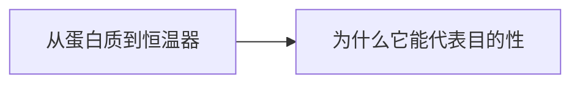

# 第 8 章：控制循环

- **难度**：★★☆ ｜ **预估学时**：0.6 小时 ｜ **前置**：ch04

## 学习目标

- 能说明负反馈与“目的性”的关系
- 能指出控制循环为什么是目的性结构的最小单元

## 一句话核心

目的性的最小实现是一个控制循环：设定目标、测量偏差、执行修正、再测量；蛋白质调控、恒温器、细菌趋化都是这个结构。

## 零基础讲解

### 概念 1：从蛋白质到恒温器（难度：基础）

蛋白质的活性位点结合底物后改变构象，抑制或激活下一步反应——这是分子级的负反馈。恒温器测温度、开关加热——同一逻辑。**负反馈**（白话：偏差越大，修正越强）让系统在扰动下维持在目标附近，这就是“目的”的最朴素形态。

### 概念 2：为什么它能代表目的性（难度：进阶）

目的性常被误解为“有意识的目标”。控制循环给出可操作的定义：系统持续把某个量拉回参考值。细菌趋化（向营养物游动）没有意识，却在做同一件事。梅菲尔德因此说：目的性可以工程化，不必神秘化。

## 图示

看图说明：方框是本章的概念顺序，箭头表示后一个概念必须建立在前一个之上。读图时先确认每个方框你都说得出一句白话定义，再往下看。

## 类比与实例

- **类比**：像洗澡调水温：手试水温，太凉就拧大热水，太烫就回调。边界：人会烦躁放弃，控制循环只按规则执行，可能震荡。
- **实例**：细菌在葡萄糖浓度梯度中游动：浓度升高就继续直游，降低就翻滚换向。结果是总体向高浓度聚集。没有传感器清单，只有“测变化—改动作”的循环。

## 常见误解

- 别以为目的性必须有意识——实际上负反馈循环就足以表现目的性行为。

## 自测题（答案）

1. 负反馈控制的核心是？
   - A. 放大偏差
   - B. 按偏差反向修正
   - C. 随机切换
   - D. 固定输出
   - **答案**：B；**解析**：偏差越大修正越强，从而把量拉回参考值。
2. 细菌趋化体现的是？
   - A. 有意识的目标
   - B. 无意识的控制循环
   - C. 随机游走
   - D. 固定程序无反馈
   - **答案**：B；**解析**：它按浓度变化调整游动方式，属于控制循环。

## 复习锚点

- 目的性最小单元 = 控制循环
- 测偏差 → 修正 → 再测
- 目的性可以被工程化定义
