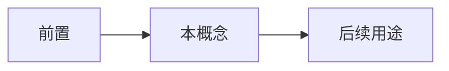

# 免费的结构与目的性结构

- **难度**：基础 ｜ **涉及章节**：第 03 章、第 04 章

## 一句话定义

免费结构由物理定律自发形成；目的性结构为实现功能而由指令生成。

## 为什么重要

这条分界线决定了哪些秩序不需要解释、哪些必须用引擎解释。

## 图示

## 详解

免费结构：雪花、晶体、对流，特点是可复现、形态种类有限、不需要指令。

目的性结构：螺丝刀、蛋白质、程序，特点是被功能约束、需要可执行指令、形态种类开放。

误用的典型：把生物结构说成“物理必然”，或把雪花说成“被设计”。两者都越界。

## 常见误解

- 别以为所有秩序都是设计出来的——实际上物理自发秩序大量存在。

## 在书中出现的脉络

| 章节 | 语境 | 关键结论 |
|---|---|---|
| ch03 | 免费结构 | 物理自发 |
| ch04 | 目的性结构 | 指令生成 |

## 相关概念

- 涌现、控制循环
