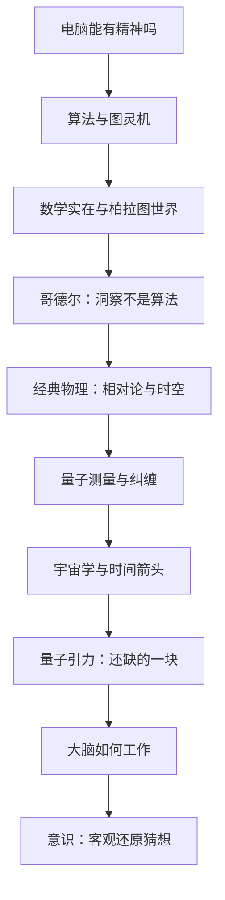

# 皇帝新脑 点化学习系统

## 这本书在讲什么

这本书的野心是把三个通常分开的问题接成一条线：计算机能不能有精神、数学真理是不是被“看出”的、量子测量与时间箭头能否解释意识。彭罗斯的论证主干是：人的数学洞察无法被任何固定算法穷尽（由哥德尔与图灵的结果推出），因此精神不等于算法；而现行物理（经典 + 量子）也不足以解释意识，需要一门尚未完成的量子引力理论。他一路铺陈算法、数学柏拉图主义、相对论、量子测量、宇宙学、脑解剖，最后落到“客观还原”（Orch OR）这个具体猜想。

## 全书心智模型

## 学习路径（推荐顺序）

| 步骤 | 章节 | 主题 | 前置 | 检查点 |
|---|---|---|---|---|
| 01 | ch01 | 第1章 电脑能有精神吗 | 无 | 完成本章自测 ≥2 题 |
| 02 | ch02 | 第2章 算法和图灵机 | ch01 | 完成本章自测 ≥2 题 |
| 03 | ch03 | 第3章 数学和实在 | ch02 | 完成本章自测 ≥2 题 |
| 04 | ch04 | 第4章 真理、证明和洞察 | ch02、ch03 | 完成本章自测 ≥2 题 |
| 05 | ch05 | 第5章 经典世界 | ch02 | 完成本章自测 ≥2 题 |
| 06 | ch06 | 第6章 量子魔术和量子神秘 | ch05 | 完成本章自测 ≥2 题 |
| 07 | ch07 | 第7章 宇宙论和时间箭头 | ch05、ch06 | 完成本章自测 ≥2 题 |
| 08 | ch08 | 第8章 量子引力的寻求 | ch05、ch06、ch07 | 完成本章自测 ≥2 题 |
| 09 | ch09 | 第9章 真实头脑和模型头脑 | ch02、ch06 | 完成本章自测 ≥2 题 |
| 10 | ch10 | 第10章 精神物理的寻求 | ch04、ch08、ch09 | 完成本章自测 ≥2 题 |

## 章节索引

- 第 1 章 第1章 电脑能有精神吗（难度 ★★）→ chapters/ch01-电脑能有精神吗.md
- 第 2 章 第2章 算法和图灵机（难度 ★★）→ chapters/ch02-算法和图灵机.md
- 第 3 章 第3章 数学和实在（难度 ★★★）→ chapters/ch03-数学和实在.md
- 第 4 章 第4章 真理、证明和洞察（难度 ★★★）→ chapters/ch04-真理-证明和洞察.md
- 第 5 章 第5章 经典世界（难度 ★★★）→ chapters/ch05-经典世界.md
- 第 6 章 第6章 量子魔术和量子神秘（难度 ★★★）→ chapters/ch06-量子魔术和量子神秘.md
- 第 7 章 第7章 宇宙论和时间箭头（难度 ★★★）→ chapters/ch07-宇宙论和时间箭头.md
- 第 8 章 第8章 量子引力的寻求（难度 ★★★）→ chapters/ch08-量子引力的寻求.md
- 第 9 章 第9章 真实头脑和模型头脑（难度 ★★）→ chapters/ch09-真实头脑和模型头脑.md
- 第 10 章 第10章 精神物理的寻求（难度 ★★★）→ chapters/ch10-精神物理的寻求.md

## 前置知识（零基础缺口补讲）

| 缺口 | 对应补讲位置 | 学完标志 |
|---|---|---|
| 算法与程序的基本概念 | ch02 概念 1–2 | 能说明“有限步骤、机械执行”是什么意思 |
| 命题、证明、公理系统 | ch04 概念 1 | 能举出一个形式系统并说出它的公理 |
| 光速不变与相对论基本结论 | ch05 概念 2 | 能解释“同时性是相对的” |
| 量子叠加与测量 | ch06 概念 1 | 能说明双缝实验里“观测改变结果”指什么 |
| 神经元与突触 | ch09 概念 1 | 能描述一个神经元如何接收与传递信号 |

## 术语表 / 模式库 / 速查表 入口

- 术语：[glossary.md](glossary.md)
- 模式与框架：[patterns.md](patterns.md)
- 速查：[cheatsheet.md](cheatsheet.md)
- 测验：[quiz.md](quiz.md)
- 抽认卡：[flashcards.md](flashcards.md)

> 单书伴侣：`emperors-new-mind学习伴侣.html`（双击即可离线学习）
