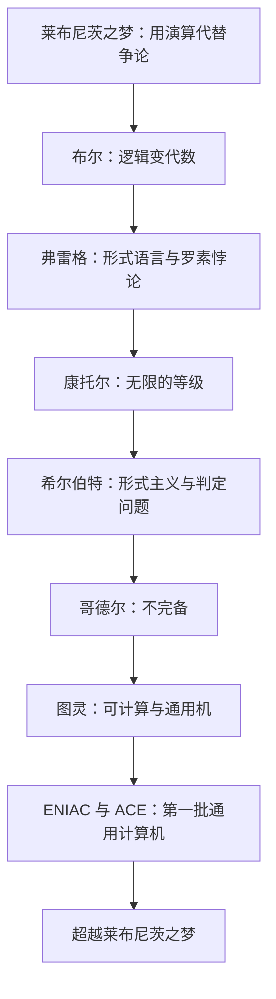

# 逻辑的引擎 点化学习系统

## 这本书在讲什么

这本书讲一台机器是怎么从哲学梦想里长出来的。莱布尼茨设想用符号演算代替争论；布尔把逻辑变成代数；弗雷格造出严格的形式语言却撞上罗素悖论；康托尔把无限分级；希尔伯特想把数学整体建立在形式上并要求一个判定程序；哥德尔证明这条路走不通；图灵用一个抽象机器重新定义了“可计算”，顺带造出了通用计算机的概念；最后 ENIAC 与 ACE 把它变成现实。戴维斯的主线是：计算机不是工程奇迹的偶然产物，它是逻辑危机逼出来的答案。

## 全书心智模型

## 学习路径（推荐顺序）

| 步骤 | 章节 | 主题 | 前置 | 检查点 |
|---|---|---|---|---|
| 01 | ch01 | 第1章 莱布尼茨之梦 | 无 | 完成本章自测 ≥2 题 |
| 02 | ch02 | 第2章 布尔把逻辑变成代数 | ch01 | 完成本章自测 ≥2 题 |
| 03 | ch03 | 第3章 弗雷格：从突破到绝望 | ch02 | 完成本章自测 ≥2 题 |
| 04 | ch04 | 第4章 康托尔：在无限中摸索 | ch03 | 完成本章自测 ≥2 题 |
| 05 | ch05 | 第5章 希尔伯特的营救 | ch04 | 完成本章自测 ≥2 题 |
| 06 | ch06 | 第6章 哥德尔使计划落空 | ch05 | 完成本章自测 ≥2 题 |
| 07 | ch07 | 第7章 图灵构想通用计算机 | ch05、ch06 | 完成本章自测 ≥2 题 |
| 08 | ch08 | 第8章 研制第一批通用计算机 | ch07 | 完成本章自测 ≥2 题 |
| 09 | ch09 | 第9章 超越莱布尼茨之梦 | 全书 | 完成本章自测 ≥2 题 |

## 章节索引

- 第 1 章 第1章 莱布尼茨之梦（难度 ★）→ chapters/ch01-莱布尼茨之梦.md
- 第 2 章 第2章 布尔把逻辑变成代数（难度 ★★）→ chapters/ch02-布尔把逻辑变成代数.md
- 第 3 章 第3章 弗雷格：从突破到绝望（难度 ★★）→ chapters/ch03-弗雷格-从突破到绝望.md
- 第 4 章 第4章 康托尔：在无限中摸索（难度 ★★★）→ chapters/ch04-康托尔-在无限中摸索.md
- 第 5 章 第5章 希尔伯特的营救（难度 ★★）→ chapters/ch05-希尔伯特的营救.md
- 第 6 章 第6章 哥德尔使计划落空（难度 ★★★）→ chapters/ch06-哥德尔使计划落空.md
- 第 7 章 第7章 图灵构想通用计算机（难度 ★★★）→ chapters/ch07-图灵构想通用计算机.md
- 第 8 章 第8章 研制第一批通用计算机（难度 ★★）→ chapters/ch08-研制第一批通用计算机.md
- 第 9 章 第9章 超越莱布尼茨之梦（难度 ★★）→ chapters/ch09-超越莱布尼茨之梦.md

## 前置知识（零基础缺口补讲）

| 缺口 | 对应补讲位置 | 学完标志 |
|---|---|---|
| 命题与真值（真/假） | ch02 概念 1 | 能把一句复合句拆成原子命题与连接词 |
| 集合与属于关系 | ch04 概念 1 | 能说明“元素属于集合”是什么意思 |
| 自然数与无限 | ch04 概念 2 | 能区分“无限多”与“无限大” |
| 公理系统的概念 | ch05 概念 1 | 能说出公理、规则、定理三者关系 |

## 术语表 / 模式库 / 速查表 入口

- 术语：[glossary.md](glossary.md)
- 模式与框架：[patterns.md](patterns.md)
- 速查：[cheatsheet.md](cheatsheet.md)
- 测验：[quiz.md](quiz.md)
- 抽认卡：[flashcards.md](flashcards.md)

> 单书伴侣：`engines-of-logic学习伴侣.html`（双击即可离线学习）
