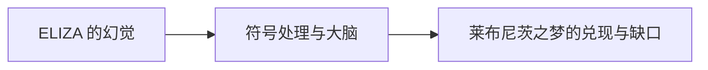

# 第 9 章：超越莱布尼茨之梦

- **难度**：★★☆ ｜ **预估学时**：0.9 小时 ｜ **前置**：全书

## 学习目标

- 能说明 ELIZA 揭示了什么、又误导了什么
- 能判断“机器能思考吗”这个问题在什么意义上仍未解决

## 一句话核心

计算机实现了莱布尼茨的“演算”部分，却没有实现“理解”部分；ELIZA 的对话幻觉提醒我们，行为像理解与真的理解之间仍有距离。

## 零基础讲解

### 概念 1：ELIZA 的幻觉（难度：基础）

ELIZA 用模式匹配把用户的句子改写成问句，例如把“我很难过”变成“你为什么难过”。它没有任何语义模型，却让不少用户以为它懂自己。戴维斯用这段真实对话说明：**行为层面的相似**极易被误读为理解。

### 概念 2：符号处理与大脑（难度：进阶）

书末把计算机与大脑放在一起看：两者都在分子层面之上做“符号处理”，但计算机的符号是人给的，大脑的符号是进化与学习形成的。戴维斯不否认机器智能的可能，只提醒“实现演算”与“拥有心灵”不是同一件事。

### 概念 3：莱布尼茨之梦的兑现与缺口（难度：高难）

兑现的部分：形式语言、可判定性、通用机、存储程序——争论确实可以变成计算。缺口：概念如何被分解、意义从哪来、意识如何出现。戴维斯把这三项留给后来者，不给廉价结论。

## 图示

看图说明：方框是本章的概念顺序，箭头表示后一个概念必须建立在前一个之上。读图时先确认每个方框你都说得出一句白话定义，再往下看。

## 类比与实例

- **类比**：像一台会自动回复的客服机器人：话术对得上，理解不一定在。边界：真人客服也可能只背话术，所以“像”与“是”的界线不靠行为判定。
- **实例**：输入“我觉得没人喜欢我”，ELIZA 回“你觉得没人喜欢你吗？”——语法正确、情绪贴合，但它没有“喜欢”的概念。把输入换成“我觉得没人恨我”，它同样能套模板，语义却反了。

## 常见误解

- 别以为通过图灵测试就等于有意识——实际上测试只检验行为不可区分，不检验内部机制。

## 自测题（答案）

1. ELIZA 的工作方式是？
   - A. 语义理解
   - B. 模式匹配与句式改写
   - C. 神经网络训练
   - D. 逻辑推理
   - **答案**：B；**解析**：它没有语义模型，只按模板重组句子。
2. 戴维斯对“机器能思考吗”的态度接近？
   - A. 已经完全实现
   - B. 行为相似不等于理解，问题仍开放
   - C. 绝不可能
   - D. 只是语言问题
   - **答案**：B；**解析**：他区分演算与心灵，不下绝对结论。

## 复习锚点

- ELIZA：模式匹配制造理解幻觉
- 计算机实现了演算，未实现意义
- 行为相似 ≠ 内部理解
