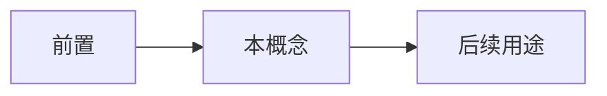

# 自指与对角线

- **难度**：高难 ｜ **涉及章节**：第 03 章、第 04 章、第 06 章

## 一句话定义

用“对象指涉自身”的构造制造矛盾或证明不可能性，对角线是它最常用的技术形式。

## 为什么重要

罗素悖论、康托尔不可数、哥德尔句、停机问题共用同一个骨架。

## 图示

## 详解

三种形态：集合自属（罗素）、逐位取反（康托尔）、命题自指（哥德尔）。

共同步骤：假设存在一个完备的列表/系统；构造一个“与每一项都不同”的对象；导出矛盾。

用途：不是制造麻烦，而是划定边界——哪些列表不可能存在，哪些系统不可能完备。

## 常见误解

- 别以为对角线只是技巧——它是关于“自我指涉”的一般方法。

## 在书中出现的脉络

| 章节 | 语境 | 关键结论 |
|---|---|---|
| ch03 | 罗素悖论 | 集合自指 |
| ch06 | 哥德尔 | 命题自指 |

## 相关概念

- 罗素悖论、哥德尔句、停机问题
