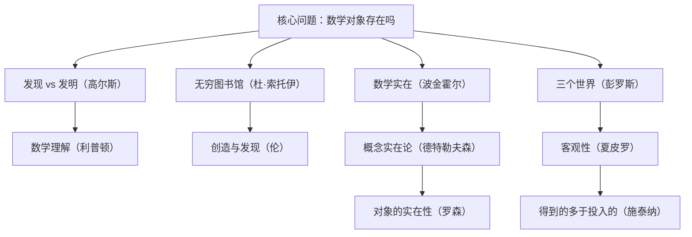

# 数学的意义 点化学习系统

## 这本书在讲什么

这是一本研讨会文集：十篇主文各提一个立场，每篇后面跟一篇评论，专门挑毛病。争论围绕一个问题：数学对象（数、集合、群）到底独立于我们存在，还是我们造出来的工具。高尔斯认为发现与发明的区分没有想象中重要；杜·索托伊把数学比作一座无穷图书馆；波金霍尔与彭罗斯倾向柏拉图式实在；伦与德特勒夫森从结构主义与概念实在论各自切入；夏皮罗讨论客观性，罗森讨论对象的实在性，施泰纳则用“我们得到的多于投入的”收尾。读这本书的正确方式是看论证怎么交锋，而不是找一个标准答案。

## 全书心智模型

## 学习路径（推荐顺序）

| 步骤 | 章节 | 主题 | 前置 | 检查点 |
|---|---|---|---|---|
| 01 | ch01 | 第1章 数学是一种发现还是一种发明？ | 无 | 完成本章自测 ≥2 题 |
| 02 | ch02 | 第2章 探索巴别数学图书馆 | ch01 | 完成本章自测 ≥2 题 |
| 03 | ch03 | 第3章 数学实在 | ch01、ch02 | 完成本章自测 ≥2 题 |
| 04 | ch04 | 第4章 数学、大脑与物理世界 | ch03 | 完成本章自测 ≥2 题 |
| 05 | ch05 | 第5章 数学的理解 | ch01、ch04 | 完成本章自测 ≥2 题 |
| 06 | ch06 | 第6章 数学中的创造和发现 | ch01、ch02 | 完成本章自测 ≥2 题 |
| 07 | ch07 | 第7章 发现、发明和实在论：概念实在性 | ch04、ch06 | 完成本章自测 ≥2 题 |
| 08 | ch08 | 第8章 数学与客观性 | ch06、ch07 | 完成本章自测 ≥2 题 |
| 09 | ch09 | 第9章 数学对象的实在性 | ch07、ch08 | 完成本章自测 ≥2 题 |
| 10 | ch10 | 第10章 我们从数学中得到的要比赋予它的多 | ch01、ch03 | 完成本章自测 ≥2 题 |

## 章节索引

- 第 1 章 第1章 数学是一种发现还是一种发明？（难度 ★★）→ chapters/ch01-数学是一种发现还是一种发明.md
- 第 2 章 第2章 探索巴别数学图书馆（难度 ★★）→ chapters/ch02-探索巴别数学图书馆.md
- 第 3 章 第3章 数学实在（难度 ★★★）→ chapters/ch03-数学实在.md
- 第 4 章 第4章 数学、大脑与物理世界（难度 ★★★）→ chapters/ch04-数学-大脑与物理世界.md
- 第 5 章 第5章 数学的理解（难度 ★★★）→ chapters/ch05-数学的理解.md
- 第 6 章 第6章 数学中的创造和发现（难度 ★★★）→ chapters/ch06-数学中的创造和发现.md
- 第 7 章 第7章 发现、发明和实在论：概念实在性（难度 ★★★）→ chapters/ch07-发现-发明和实在论-概念实在性.md
- 第 8 章 第8章 数学与客观性（难度 ★★★）→ chapters/ch08-数学与客观性.md
- 第 9 章 第9章 数学对象的实在性（难度 ★★★）→ chapters/ch09-数学对象的实在性.md
- 第 10 章 第10章 我们从数学中得到的要比赋予它的多（难度 ★★★）→ chapters/ch10-我们从数学中得到的要比赋予它的多.md

## 前置知识（零基础缺口补讲）

| 缺口 | 对应补讲位置 | 学完标志 |
|---|---|---|
| 命题逻辑与“蕴含” | ch01 概念 1 | 能说明“如果…那么…”与“所以”的区别 |
| 集合与无穷 | ch03 概念 2 | 能区分可数无限与不可数无限 |
| 哥德尔定理的结论 | ch04 概念 2 | 能说出“一致则不完备” |
| 复数与欧拉公式 | ch10 概念 1 | 能写出 e^{iπ}+1=0 |

## 术语表 / 模式库 / 速查表 入口

- 术语：[glossary.md](glossary.md)
- 模式与框架：[patterns.md](patterns.md)
- 速查：[cheatsheet.md](cheatsheet.md)
- 测验：[quiz.md](quiz.md)
- 抽认卡：[flashcards.md](flashcards.md)

> 单书伴侣：`meaning-of-math学习伴侣.html`（双击即可离线学习）
