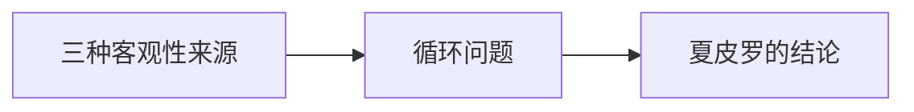

# 第 8 章：数学与客观性

- **难度**：★★★ ｜ **预估学时**：1.1 小时 ｜ **前置**：ch06、ch07

## 学习目标

- 能说明数学客观性的三种来源
- 能指出“客观性标准预设逻辑”这一循环

## 一句话核心

数学的客观性不一定要靠对象存在来保证：它可能来自共识、来自证明的可检查性、来自逻辑的强制；但任何一种解释都要先假定一套逻辑。

## 零基础讲解

### 概念 1：三种客观性来源（难度：进阶）

①**对象客观性**：有一个独立世界。②**程序客观性**：证明可被任何人按规则检查，因此结论不由个人偏好决定。③**规范客观性**：数学结论对任何理性主体都成立。夏皮罗逐一分析，指出三者可以互相支持，但都不能独立成立。

### 概念 2：循环问题（难度：高难）

要判断“客观”，你得先有一套判定标准；这套标准本身来自逻辑；逻辑的客观性又需要被证明。循环无法完全消除，只能靠“实践中的稳定”来打断：某些逻辑规则在长期使用中未被推翻。

### 概念 3：夏皮罗的结论（难度：高难）

他倾向一种温和的客观性：数学不是任意约定，但也不是对独立世界的描摹，而是受规则与共同体实践共同约束的活动。这个立场不漂亮，但能容纳数学史的实际变化。

## 图示

看图说明：方框是本章的概念顺序，箭头表示后一个概念必须建立在前一个之上。读图时先确认每个方框你都说得出一句白话定义，再往下看。

## 类比与实例

- **类比**：像法庭上的证据标准：标准本身也要被辩护，最后只能落到“我们共同体接受这套程序”。边界：法庭可以被推翻，数学证明一旦成立很难被推翻。
- **实例**：同一道证明，不同数学家按同一规则检查会得到同一结论；这不是因为他们有相同的心理，而是因为规则对外公开、可重复。程序客观性就落在这里。

## 常见误解

- 别以为客观就等于“有一个对象在那里”——实际上程序与规范的客观性也能支撑数学的强制性。

## 自测题（答案）

1. “程序客观性”指的是？
   - A. 对象独立存在
   - B. 证明可被任何人按规则复查
   - C. 数学家的共识
   - D. 计算速度快
   - **答案**：B；**解析**：可检查性使结论不依赖个人。
2. 客观性标准的循环指？
   - A. 证明太长
   - B. 判断客观需先有逻辑，逻辑的客观又需证明
   - C. 数学家意见不一
   - D. 对象太多
   - **答案**：B；**解析**：标准与逻辑互相依赖，形成循环。

## 复习锚点

- 三种客观性：对象 / 程序 / 规范
- 循环只能靠实践稳定打断
- 温和客观性：规则 + 共同体
