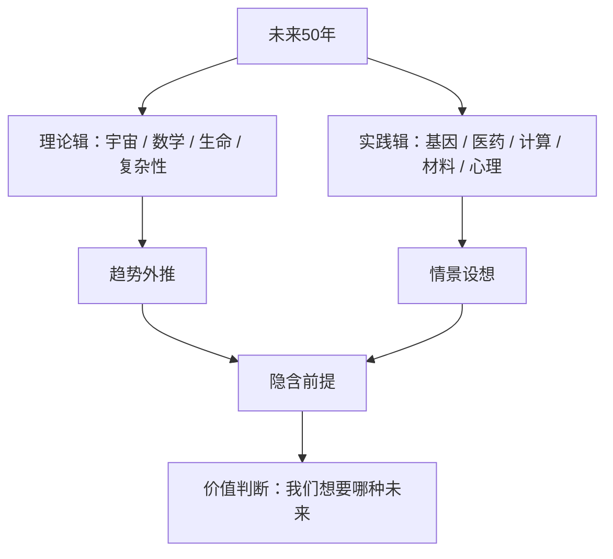

# 未来50年 点化学习系统

## 这本书在讲什么

这是一本“命题作文集”：编者请一批科学家各写一篇，题目是未来五十年会怎样。文章分成两辑，第一辑谈理论（宇宙、数学、生命、复杂性），第二辑谈实践（基因、医药、计算、材料、心理、社会）。读它的正确方式不是记住预测，而是看每个人如何从自己的领域出发，把当下的趋势推到一个具体场景，再暴露这个推演依赖哪些前提。二十五篇文章放在一起，本身就是一份“预测方法论”的样本。

## 全书心智模型

## 学习路径（推荐顺序）

| 步骤 | 章节 | 主题 | 前置 | 检查点 |
|---|---|---|---|---|
| 01 | ch01 | 宇宙的未来 | 无 | 完成本章自测 ≥2 题 |
| 02 | ch02 | 我们孤独吗我们在哪儿 | ch01 | 完成本章自测 ≥2 题 |
| 03 | ch03 | 2050年的数学 | 无 | 完成本章自测 ≥2 题 |
| 04 | ch04 | 在文化的阴影里 | 无 | 完成本章自测 ≥2 题 |
| 05 | ch05 | 替换大脑 | 无 | 完成本章自测 ≥2 题 |
| 06 | ch06 | 儿童会告诉科学家什么 | 无 | 完成本章自测 ≥2 题 |
| 07 | ch07 | 走向道德发展的理论 | ch06 | 完成本章自测 ≥2 题 |
| 08 | ch08 | 捉摸不定的心理学 | ch07 | 完成本章自测 ≥2 题 |
| 09 | ch09 | 幸福的未来 | ch08 | 完成本章自测 ≥2 题 |
| 10 | ch10 | 50年后我们还会忧伤吗 | ch09 | 完成本章自测 ≥2 题 |
| 11 | ch11 | 费米的“小发现”和复杂性理论的未来 | 无 | 完成本章自测 ≥2 题 |
| 12 | ch12 | 生命是什么 | 无 | 完成本章自测 ≥2 题 |
| 13 | ch13 | 小摩尔定律 | 无 | 完成本章自测 ≥2 题 |
| 14 | ch14 | 第二个创生 | ch12 | 完成本章自测 ≥2 题 |
| 15 | ch15 | 预测未来 | ch11 | 完成本章自测 ≥2 题 |
| 16 | ch16 | 肉体与机器的结合 | 无 | 完成本章自测 ≥2 题 |
| 17 | ch17 | 物质的未来 | 无 | 完成本章自测 ≥2 题 |
| 18 | ch18 | 我们会更聪明吗 | 无 | 完成本章自测 ≥2 题 |
| 19 | ch19 | 复杂性的顶点 | 无 | 完成本章自测 ≥2 题 |
| 20 | ch20 | 流动的信息 | 无 | 完成本章自测 ≥2 题 |
| 21 | ch21 | 思想，大脑和自我 | 无 | 完成本章自测 ≥2 题 |
| 22 | ch22 | 我们何以如此：来自2050年的观点 | ch06、ch09 | 完成本章自测 ≥2 题 |
| 23 | ch23 | 药、DNA和躺椅 | ch10 | 完成本章自测 ≥2 题 |
| 24 | ch24 | 心理疗法和穿在身上的电脑 | ch20、ch23 | 完成本章自测 ≥2 题 |
| 25 | ch25 | 征服疾病 | ch23 | 完成本章自测 ≥2 题 |

## 章节索引

- 第 1 章 宇宙的未来（难度 ★★）→ chapters/ch01-宇宙的未来.md
- 第 2 章 我们孤独吗我们在哪儿（难度 ★★）→ chapters/ch02-我们孤独吗我们在哪儿.md
- 第 3 章 2050年的数学（难度 ★★）→ chapters/ch03-2050年的数学.md
- 第 4 章 在文化的阴影里（难度 ★★）→ chapters/ch04-在文化的阴影里.md
- 第 5 章 替换大脑（难度 ★★★）→ chapters/ch05-替换大脑.md
- 第 6 章 儿童会告诉科学家什么（难度 ★★）→ chapters/ch06-儿童会告诉科学家什么.md
- 第 7 章 走向道德发展的理论（难度 ★★）→ chapters/ch07-走向道德发展的理论.md
- 第 8 章 捉摸不定的心理学（难度 ★★★）→ chapters/ch08-捉摸不定的心理学.md
- 第 9 章 幸福的未来（难度 ★★）→ chapters/ch09-幸福的未来.md
- 第 10 章 50年后我们还会忧伤吗（难度 ★★）→ chapters/ch10-50年后我们还会忧伤吗.md
- 第 11 章 费米的“小发现”和复杂性理论的未来（难度 ★★★）→ chapters/ch11-费米的-小发现-和复杂性理论的未来.md
- 第 12 章 生命是什么（难度 ★★★）→ chapters/ch12-生命是什么.md
- 第 13 章 小摩尔定律（难度 ★★★）→ chapters/ch13-小摩尔定律.md
- 第 14 章 第二个创生（难度 ★★★）→ chapters/ch14-第二个创生.md
- 第 15 章 预测未来（难度 ★★）→ chapters/ch15-预测未来.md
- 第 16 章 肉体与机器的结合（难度 ★★）→ chapters/ch16-肉体与机器的结合.md
- 第 17 章 物质的未来（难度 ★★）→ chapters/ch17-物质的未来.md
- 第 18 章 我们会更聪明吗（难度 ★★）→ chapters/ch18-我们会更聪明吗.md
- 第 19 章 复杂性的顶点（难度 ★★★）→ chapters/ch19-复杂性的顶点.md
- 第 20 章 流动的信息（难度 ★★）→ chapters/ch20-流动的信息.md
- 第 21 章 思想，大脑和自我（难度 ★★★）→ chapters/ch21-思想-大脑和自我.md
- 第 22 章 我们何以如此：来自2050年的观点（难度 ★★）→ chapters/ch22-我们何以如此-来自2050年的观点.md
- 第 23 章 药、DNA和躺椅（难度 ★★）→ chapters/ch23-药-DNA和躺椅.md
- 第 24 章 心理疗法和穿在身上的电脑（难度 ★★★）→ chapters/ch24-心理疗法和穿在身上的电脑.md
- 第 25 章 征服疾病（难度 ★★）→ chapters/ch25-征服疾病.md

## 前置知识（零基础缺口补讲）

| 缺口 | 对应补讲位置 | 学完标志 |
|---|---|---|
| 宇宙膨胀与暗能量的基本概念 | ch01 概念 1 | 能说明“加速膨胀”是什么意思 |
| DNA 与基因测序 | ch13 概念 1 | 能说出测序是在读什么 |
| 行为主义与认知主义的区别 | ch07 概念 1 | 能说明“刺激-反应”与“内部表征”的差别 |
| 摩尔定律 | ch13 概念 2 | 能说出“每两年翻倍”指什么 |

## 术语表 / 模式库 / 速查表 入口

- 术语：[glossary.md](glossary.md)
- 模式与框架：[patterns.md](patterns.md)
- 速查：[cheatsheet.md](cheatsheet.md)
- 测验：[quiz.md](quiz.md)
- 抽认卡：[flashcards.md](flashcards.md)

> 单书伴侣：`next-fifty-years学习伴侣.html`（双击即可离线学习）
