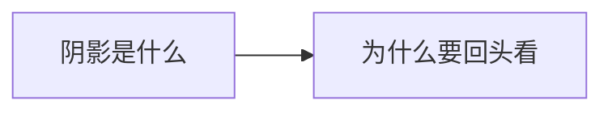

# 第 4 章：在文化的阴影里

- **难度**：★★☆ ｜ **预估学时**：0.5 小时 ｜ **前置**：无

## 学习目标

- 能说明“阴影”指的是哪些被忽略的文化与知识
- 能解释为什么作者要“把目光从未来移开”

## 一句话核心

预测未来的前提是看清现在；而现在的大部分被主流叙事遮住，作者要求先看清“阴影里的文化”，再谈五十年。

## 零基础讲解

### 概念 1：阴影是什么（难度：基础）

指非西方、非主流、非文本化的知识传统：地方性技术、口传医学、被殖民史压掉的科学实践。它们不在期刊里，却影响着多数人的生活。

### 概念 2：为什么要回头看（难度：进阶）

作者认为未来学容易变成主流文化的自我投射。先把目光从未来移开，才能发现哪些“必然趋势”其实是特定文化的偏好。

## 图示

看图说明：方框是本章的概念顺序，箭头表示后一个概念必须建立在前一个之上。读图时先确认每个方框你都说得出一句白话定义，再往下看。

## 类比与实例

- **类比**：像拍照时只看取景框：框外的景物一样真实，只是没进画面。边界：阴影里的知识也需要检验，不能因为“非主流”就自动正确。
- **实例**：同一场流行病，主流方案是疫苗与抗生素，地方经验可能是隔离、草药、社区互助。两者都需要证据检验，但后者常被直接忽略。

## 常见误解

- 别以为“非主流”就等于“更智慧”——它同样需要证据，只是不该被默认为无关。

## 自测题（答案）

1. 作者主张先看“阴影”的理由是？
   - A. 未来无法预测
   - B. 避免把主流文化的偏好当成普遍趋势
   - C. 阴影更先进
   - D. 数据不足
   - **答案**：B；**解析**：先看清现在，才能识别预测里的文化投射。

## 复习锚点

- 阴影 = 被主流叙事遮住的知识
- 未来学常是文化自我投射
- 非主流也要检验
