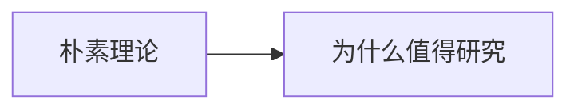

# 第 6 章：儿童会告诉科学家什么

- **难度**：★★☆ ｜ **预估学时**：0.5 小时 ｜ **前置**：无

## 学习目标

- 能说明儿童为什么是“理论建构者”而非“空容器”
- 能举一个儿童朴素理论被实验修正的例子

## 一句话核心

儿童不是被动接收信息，而是自己造朴素理论来解释世界；研究这些理论怎么被修正，是理解学习机制的捷径。

## 零基础讲解

### 概念 1：朴素理论（难度：基础）

幼儿会认为“重的物体沉得快”“月亮跟着自己走”。这些不是随机错误，而是有结构的**朴素理论**（naive theory）。它们像科学理论一样，能预测、能解释，也能被反例推翻。

### 概念 2：为什么值得研究（难度：进阶）

成人已经忘了自己怎么学会的；儿童正在建构的过程中，所以能观察到“概念改变”的现场。这对教育设计与 AI 学习都有参考价值。

## 图示

看图说明：方框是本章的概念顺序，箭头表示后一个概念必须建立在前一个之上。读图时先确认每个方框你都说得出一句白话定义，再往下看。

## 类比与实例

- **类比**：像一个小科学家在没有实验室的条件下造模型：材料少，推理多。边界：儿童不写论文、不做对照实验，理论改变靠日常反例。
- **实例**：给 4 岁儿童看两个球同时落地，他会惊讶；重复几次后，他会修改“重的先落地”的规则。这个修正过程可被记录、被比较。

## 常见误解

- 别以为儿童只是“不懂”——他们的错误有系统结构，是可研究的理论。

## 自测题（答案）

1. “朴素理论”指的是？
   - A. 儿童随机猜测
   - B. 儿童自造的有结构解释
   - C. 成人简化版物理
   - D. 教科书的简化
   - **答案**：B；**解析**：它有预测与解释结构，能被反例修正。

## 复习锚点

- 儿童 = 理论建构者
- 错误有结构
- 概念改变可现场观察
