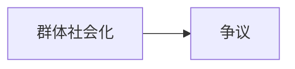

# 第 22 章：我们何以如此：来自2050年的观点

- **难度**：★★☆ ｜ **预估学时**：0.6 小时 ｜ **前置**：ch06、ch09

## 学习目标

- 能说明“群体社会化”理论的主张
- 能指出它对“父母决定孩子人格”的挑战

## 一句话核心

同辈群体而非父母，是儿童社会化的主要环境；父母提供基因与家庭氛围，但人格的塑造更多发生在同伴之间。

## 零基础讲解

### 概念 1：群体社会化（难度：进阶）

哈里斯的理论：儿童在家庭外发展“群体内”行为规范，同伴接纳与地位压力塑造社会行为。家庭教养的影响被高估，基因与非共享环境被低估。

### 概念 2：争议（难度：进阶）

批评者指出：父母仍通过选择居住地、学校、同伴圈间接影响；基因与环境的交互也无法完全分离。理论的价值在于纠正“父母万能论”。

## 图示

看图说明：方框是本章的概念顺序，箭头表示后一个概念必须建立在前一个之上。读图时先确认每个方框你都说得出一句白话定义，再往下看。

## 类比与实例

- **类比**：像孩子在学校学会一套“宿舍方言”，回家仍说家乡话：两套规范并行。边界：家庭规范并非无效，只是不是唯一来源。
- **实例**：移民家庭的孩子在语言与口音上更像同伴而非父母，这个现象是群体社会化的直接证据。

## 常见误解

- 别以为这理论在说“父母不重要”——它说的是父母的影响路径不同，更多是间接的。

## 自测题（答案）

1. 群体社会化理论强调？
   - A. 父母决定人格
   - B. 同伴群体是主要社会化环境
   - C. 基因无用
   - D. 学校无关
   - **答案**：B；**解析**：同辈规范与接纳塑造社会行为。

## 复习锚点

- 同伴群体是主要社会化环境
- 父母影响多为间接
- 纠偏“父母万能论”
