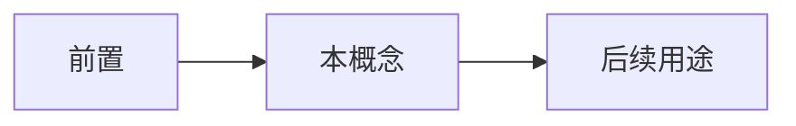

# 信息与意义

- **难度**：进阶 ｜ **涉及章节**：第 13 章、第 20 章、第 21 章

## 一句话定义

信息是可减少不确定性的差异；意义是这些差异在某个解释系统中的作用。

## 为什么重要

它是贯穿全书的一条暗线：测序、泛在计算、脑成像都在“读信息”，但都不等于“懂意义”。

## 图示

## 详解

读：获取差异（序列、信号、图像）。

懂：把差异接到功能、语境、因果上。

代价：读的成本在下降，懂的成本没有同步下降。

风险：把“读到了”当成“明白了”，是当代许多技术乐观论的共同错误。

## 常见误解

- 别以为数据量增加就等于理解增加——理解需要解释框架与实验。

## 在书中出现的脉络

| 章节 | 语境 | 关键结论 |
|---|---|---|
| ch13 | 小摩尔定律 | 读≠懂 |
| ch21 | 脑成像 | 相关≠因果 |

## 相关概念

- 测序、泛在计算、脑成像
