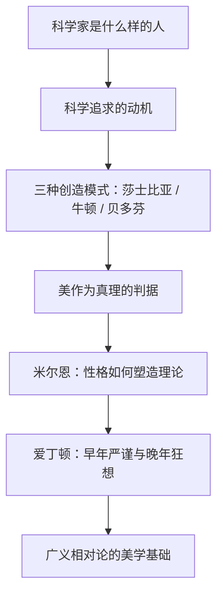

# 真理与美 点化学习系统

## 这本书在讲什么

这是钱德拉塞卡七篇演讲的合集，主题是科学家的动机与创造力的形态。他先讲科学家是什么样的人，再讲驱动科学追求的几种动机；最著名的一篇比较莎士比亚、牛顿、贝多芬的创造轨迹，提出三种模式：早年即巅峰、一次爆发后转向、持续上升到晚年。后几篇讨论科学中的美（以狄拉克与拉马努金为例）、米尔恩与爱丁顿这两位性格强烈的天体物理学家，以及广义相对论的美学基础。全书的核心不是知识，而是“做科学这件事在人的一生里长什么样”。

## 全书心智模型

## 学习路径（推荐顺序）

| 步骤 | 章节 | 主题 | 前置 | 检查点 |
|---|---|---|---|---|
| 01 | ch01 | 第1章 科学家（1946） | 无 | 完成本章自测 ≥2 题 |
| 02 | ch02 | 第2章 科学的追求及其动机（1985） | ch01 | 完成本章自测 ≥2 题 |
| 03 | ch03 | 第3章 莎士比亚、牛顿和贝多芬：不同的创造模式 | ch02 | 完成本章自测 ≥2 题 |
| 04 | ch04 | 第4章 美与科学对美的探求（1979） | ch03 | 完成本章自测 ≥2 题 |
| 05 | ch05 | 第5章 米尔恩讲座：米尔恩与现代天体物理 | ch01、ch02 | 完成本章自测 ≥2 题 |
| 06 | ch06 | 第6章 纪念爱丁顿诞辰一百周年 | ch05 | 完成本章自测 ≥2 题 |
| 07 | ch07 | 第7章 史瓦西讲座：广义相对论的美学基础 | ch06 | 完成本章自测 ≥2 题 |

## 章节索引

- 第 1 章 第1章 科学家（1946）（难度 ★）→ chapters/ch01-科学家-1946.md
- 第 2 章 第2章 科学的追求及其动机（1985）（难度 ★★）→ chapters/ch02-科学的追求及其动机-1985.md
- 第 3 章 第3章 莎士比亚、牛顿和贝多芬：不同的创造模式（难度 ★★★）→ chapters/ch03-莎士比亚-牛顿和贝多芬-不同的创造模式.md
- 第 4 章 第4章 美与科学对美的探求（1979）（难度 ★★★）→ chapters/ch04-美与科学对美的探求-1979.md
- 第 5 章 第5章 米尔恩讲座：米尔恩与现代天体物理（难度 ★★）→ chapters/ch05-米尔恩讲座-米尔恩与现代天体物理.md
- 第 6 章 第6章 纪念爱丁顿诞辰一百周年（难度 ★★★）→ chapters/ch06-纪念爱丁顿诞辰一百周年.md
- 第 7 章 第7章 史瓦西讲座：广义相对论的美学基础（难度 ★★★）→ chapters/ch07-史瓦西讲座-广义相对论的美学基础.md

## 前置知识（零基础缺口补讲）

| 缺口 | 对应补讲位置 | 学完标志 |
|---|---|---|
| 科学革命的基本脉络（哥白尼—开普勒—牛顿） | ch02 概念 1 | 能说出开普勒三定律各说什么 |
| 相对论的基本结论 | ch07 概念 1 | 能说明“时空弯曲”指什么 |
| 恒星演化与白矮星 | ch05 概念 1 | 能说明恒星靠什么抵抗引力 |
| 数学美的直觉（对称、简洁） | ch04 概念 1 | 能说出一个“简洁公式解释大量现象”的例子 |

## 术语表 / 模式库 / 速查表 入口

- 术语：[glossary.md](glossary.md)
- 模式与框架：[patterns.md](patterns.md)
- 速查：[cheatsheet.md](cheatsheet.md)
- 测验：[quiz.md](quiz.md)
- 抽认卡：[flashcards.md](flashcards.md)

> 单书伴侣：`truth-and-beauty学习伴侣.html`（双击即可离线学习）
