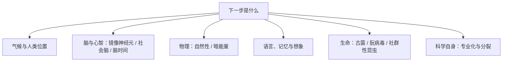

# 下一步是什么 点化学习系统

## 这本书在讲什么

编者给一批科学家出了同一道题：你的领域下一步是什么。十八篇短文覆盖气候、神经科学、物理学、语言学、进化生物学与科学社会学。它们不是综述，而是各自把“现在卡在哪”讲清楚：镜像神经元到底证明了什么、暗能量为什么让物理学家不舒服、青少年大脑为什么容易冒险、语言是否真的塑造思维、记忆能不能被药物增强或擦除。读法是把每篇的“已知”与“未知”分开，别把作者的方向感当成定论。

## 全书心智模型

## 学习路径（推荐顺序）

| 步骤 | 章节 | 主题 | 前置 | 检查点 |
|---|---|---|---|---|
| 01 | ch01 | 我们将撤往北缘地区？ | 无 | 完成本章自测 ≥2 题 |
| 02 | ch02 | 镜像神经元：我们天生就合乎道德吗？ | 无 | 完成本章自测 ≥2 题 |
| 03 | ch03 | 如何增强人自身 | ch02 | 完成本章自测 ≥2 题 |
| 04 | ch04 | 我们在非自然宇宙中的位置 | 无 | 完成本章自测 ≥2 题 |
| 05 | ch05 | 暗能量到底是什么？ | ch04 | 完成本章自测 ≥2 题 |
| 06 | ch06 | 青少年中社会脑的发展 | ch02 | 完成本章自测 ≥2 题 |
| 07 | ch07 | 观察大脑的互动 | ch06 | 完成本章自测 ≥2 题 |
| 08 | ch08 | 是什么使得大观念如此牢固？ | ch07 | 完成本章自测 ≥2 题 |
| 09 | ch09 | 道德心灵的生理学基础 | ch08 | 完成本章自测 ≥2 题 |
| 10 | ch10 | 语言是如何影响我们思考的？ | 无 | 完成本章自测 ≥2 题 |
| 11 | ch11 | 记忆增强，记忆擦除：我们过去的未来 | ch07 | 完成本章自测 ≥2 题 |
| 12 | ch12 | 想象的极端重要性 | ch11 | 完成本章自测 ≥2 题 |
| 13 | ch13 | 脑时间 | ch07 | 完成本章自测 ≥2 题 |
| 14 | ch14 | 超越大脑：为什么智人从树上下来 | ch12 | 完成本章自测 ≥2 题 |
| 15 | ch15 | 我们当中的外来者 | 无 | 完成本章自测 ≥2 题 |
| 16 | ch16 | 社群性昆虫是如何变得具有社会性的？ | ch15 | 完成本章自测 ≥2 题 |
| 17 | ch17 | 人类的灭绝和进化 | ch16 | 完成本章自测 ≥2 题 |
| 18 | ch18 | 为什么专业化没有导致科学四分五裂？ | 无 | 完成本章自测 ≥2 题 |

## 章节索引

- 第 1 章 我们将撤往北缘地区？（难度 ★★）→ chapters/ch01-我们将撤往北缘地区.md
- 第 2 章 镜像神经元：我们天生就合乎道德吗？（难度 ★★★）→ chapters/ch02-镜像神经元-我们天生就合乎道德吗.md
- 第 3 章 如何增强人自身（难度 ★★）→ chapters/ch03-如何增强人自身.md
- 第 4 章 我们在非自然宇宙中的位置（难度 ★★★）→ chapters/ch04-我们在非自然宇宙中的位置.md
- 第 5 章 暗能量到底是什么？（难度 ★★★）→ chapters/ch05-暗能量到底是什么.md
- 第 6 章 青少年中社会脑的发展（难度 ★★）→ chapters/ch06-青少年中社会脑的发展.md
- 第 7 章 观察大脑的互动（难度 ★★★）→ chapters/ch07-观察大脑的互动.md
- 第 8 章 是什么使得大观念如此牢固？（难度 ★★★）→ chapters/ch08-是什么使得大观念如此牢固.md
- 第 9 章 道德心灵的生理学基础（难度 ★★★）→ chapters/ch09-道德心灵的生理学基础.md
- 第 10 章 语言是如何影响我们思考的？（难度 ★★★）→ chapters/ch10-语言是如何影响我们思考的.md
- 第 11 章 记忆增强，记忆擦除：我们过去的未来（难度 ★★）→ chapters/ch11-记忆增强-记忆擦除-我们过去的未来.md
- 第 12 章 想象的极端重要性（难度 ★★）→ chapters/ch12-想象的极端重要性.md
- 第 13 章 脑时间（难度 ★★★）→ chapters/ch13-脑时间.md
- 第 14 章 超越大脑：为什么智人从树上下来（难度 ★★★）→ chapters/ch14-超越大脑-为什么智人从树上下来.md
- 第 15 章 我们当中的外来者（难度 ★★★）→ chapters/ch15-我们当中的外来者.md
- 第 16 章 社群性昆虫是如何变得具有社会性的？（难度 ★★★）→ chapters/ch16-社群性昆虫是如何变得具有社会性的.md
- 第 17 章 人类的灭绝和进化（难度 ★★）→ chapters/ch17-人类的灭绝和进化.md
- 第 18 章 为什么专业化没有导致科学四分五裂？（难度 ★★）→ chapters/ch18-为什么专业化没有导致科学四分五裂.md

## 前置知识（零基础缺口补讲）

| 缺口 | 对应补讲位置 | 学完标志 |
|---|---|---|
| 神经元与突触的基本概念 | ch02 概念 1 | 能说出“神经元放电”是什么 |
| 标准模型与自然常数的概念 | ch04 概念 1 | 能说出“精细结构常数”大致含义 |
| 进化的基本机制（变异与选择） | ch16 概念 1 | 能说明“亲缘选择”指什么 |
| 脑成像的基本原理 | ch07 概念 1 | 能说出 fMRI 测的是什么 |

## 术语表 / 模式库 / 速查表 入口

- 术语：[glossary.md](glossary.md)
- 模式与框架：[patterns.md](patterns.md)
- 速查：[cheatsheet.md](cheatsheet.md)
- 测验：[quiz.md](quiz.md)
- 抽认卡：[flashcards.md](flashcards.md)

> 单书伴侣：`whats-next学习伴侣.html`（双击即可离线学习）
