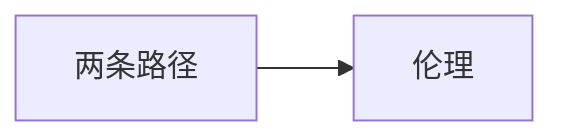

# 第 11 章：记忆增强，记忆擦除：我们过去的未来

- **难度**：★★☆ ｜ **预估学时**：0.5 小时 ｜ **前置**：ch07

## 学习目标

- 能区分“增强记忆”与“擦除记忆”的技术路径
- 能指出记忆干预的伦理问题

## 一句话核心

记忆可以被药物与干预调节：增强巩固、削弱再巩固；技术上可行的一部分已经在动物与早期临床中出现，伦理争议比技术更快到来。

## 零基础讲解

### 概念 1：两条路径（难度：基础）

**增强**：促进突触巩固（如某些促智药、睡眠干预）。**削弱**：在记忆被唤起后的“再巩固窗口”内用药或干预，使情绪记忆淡化。

### 概念 2：伦理（难度：进阶）

记忆是人格的一部分：擦除创伤可能救人，也可能抹掉证人证词、改变自我叙述。作者主张区分“治疗性淡化”与“选择性删除”，后者需要更强的公共约束。

## 图示

看图说明：方框是本章的概念顺序，箭头表示后一个概念必须建立在前一个之上。读图时先确认每个方框你都说得出一句白话定义，再往下看。

## 类比与实例

- **类比**：像编辑一段录像：可以调亮、可以剪掉，但剪掉的那段也是你的历史。边界：录像有备份，记忆没有。
- **实例**：PTSD 的干预研究在唤起记忆后给予特定药物，复发率下降；同一机制若用于证人，就会破坏证据链。

## 常见误解

- 别以为记忆像文件可以随意删除——每次唤起都会重写，删除也伴随重构。

## 自测题（答案）

1. “再巩固窗口”指的是？
   - A. 记忆形成前
   - B. 记忆被唤起后可被修改的时段
   - C. 睡眠期
   - D. 婴儿期
   - **答案**：B；**解析**：唤起后记忆暂时不稳定，可被干预。

## 复习锚点

- 增强巩固 vs 削弱再巩固
- 记忆即人格
- 治疗与证据的边界
