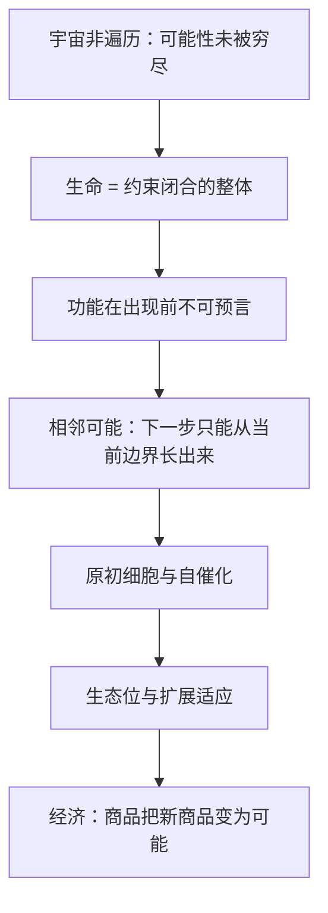

# 物理之外的世界 点化学习系统

## 这本书在讲什么

考夫曼要回答一个问题：物理定律能推出生命吗？他的答案是不能，而且不是“暂时不能”，而是原则上不能。理由有三层：宇宙的粒子数与时间有限，从未遍历所有可能的分子组合；生命体是“约束闭合”的整体，它的功能在出现前无法被物理预言；演化不是被定律推出的，而是不断把“相邻可能”变成现实。后几章把这套论证延伸到新陈代谢、原初细胞、生态位与经济。全书的核心不是生物学知识，而是一种关于“新事物如何出现”的世界观。

## 全书心智模型

## 学习路径（推荐顺序）

| 步骤 | 章节 | 主题 | 前置 | 检查点 |
|---|---|---|---|---|
| 01 | ch01 | 第1章 世界不是一台机器 | 无 | 完成本章自测 ≥2 题 |
| 02 | ch02 | 第2章 功能的功能 | ch01 | 完成本章自测 ≥2 题 |
| 03 | ch03 | 第3章 传播组织 | ch02 | 完成本章自测 ≥2 题 |
| 04 | ch04 | 第4章 解密生命 | ch03 | 完成本章自测 ≥2 题 |
| 05 | ch05 | 第5章 如何制造新陈代谢 | ch04 | 完成本章自测 ≥2 题 |
| 06 | ch06 | 第6章 原初细胞 | ch05 | 完成本章自测 ≥2 题 |
| 07 | ch07 | 第7章 可遗传变异 | ch06 | 完成本章自测 ≥2 题 |
| 08 | ch08 | 第8章 我们玩的游戏 | ch07 | 完成本章自测 ≥2 题 |
| 09 | ch09 | 第9章 舞台已经搭好了 | ch08 | 完成本章自测 ≥2 题 |
| 10 | ch10 | 第10章 扩展适应和螺丝刀 | ch09 | 完成本章自测 ≥2 题 |
| 11 | ch11 | 第11章 物理之外的世界 | ch10 | 完成本章自测 ≥2 题 |

## 章节索引

- 第 1 章 第1章 世界不是一台机器（难度 ★★★）→ chapters/ch01-世界不是一台机器.md
- 第 2 章 第2章 功能的功能（难度 ★★★）→ chapters/ch02-功能的功能.md
- 第 3 章 第3章 传播组织（难度 ★★★）→ chapters/ch03-传播组织.md
- 第 4 章 第4章 解密生命（难度 ★★★）→ chapters/ch04-解密生命.md
- 第 5 章 第5章 如何制造新陈代谢（难度 ★★★）→ chapters/ch05-如何制造新陈代谢.md
- 第 6 章 第6章 原初细胞（难度 ★★★）→ chapters/ch06-原初细胞.md
- 第 7 章 第7章 可遗传变异（难度 ★★★）→ chapters/ch07-可遗传变异.md
- 第 8 章 第8章 我们玩的游戏（难度 ★★★）→ chapters/ch08-我们玩的游戏.md
- 第 9 章 第9章 舞台已经搭好了（难度 ★★）→ chapters/ch09-舞台已经搭好了.md
- 第 10 章 第10章 扩展适应和螺丝刀（难度 ★★★）→ chapters/ch10-扩展适应和螺丝刀.md
- 第 11 章 第11章 物理之外的世界（难度 ★★★）→ chapters/ch11-物理之外的世界.md

## 前置知识（零基础缺口补讲）

| 缺口 | 对应补讲位置 | 学完标志 |
|---|---|---|
| 蛋白质与氨基酸的基本概念 | ch01 概念 1 | 能说出蛋白质由氨基酸链折叠而成 |
| DNA 碱基配对与转录 | ch04 概念 1 | 能说明 A-T、C-G 配对 |
| 自催化反应 | ch05 概念 1 | 能说出“产物催化自己的生成” |
| 生态位 | ch09 概念 1 | 能说明“一个物种在群落中的位置与资源” |

## 术语表 / 模式库 / 速查表 入口

- 术语：[glossary.md](glossary.md)
- 模式与框架：[patterns.md](patterns.md)
- 速查：[cheatsheet.md](cheatsheet.md)
- 测验：[quiz.md](quiz.md)
- 抽认卡：[flashcards.md](flashcards.md)

> 单书伴侣：`world-beyond-physics学习伴侣.html`（双击即可离线学习）
