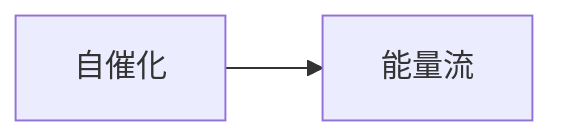

# 第 5 章：如何制造新陈代谢

- **难度**：★★★ ｜ **预估学时**：0.7 小时 ｜ **前置**：ch04

## 学习目标

- 能说明自催化集合如何维持代谢
- 能解释能量流在代谢中的位置

## 一句话核心

代谢是一张自催化网络：反应的产物反过来催化生成它的反应；网络靠外部能量梯度驱动，靠约束闭合维持。

## 零基础讲解

### 概念 1：自催化（难度：进阶）

**自催化集合**（autocatalytic set）：每个分子的生成至少被集合内另一个分子催化，整体不依赖外部催化剂。考夫曼用随机图论证：当分子种类与反应数超过阈值，自催化集合几乎必然出现。

### 概念 2：能量流（难度：进阶）

自催化只解决“怎么维持结构”，还需要“怎么驱动”。反应物化学能高于产物，能量沿链条下降，外部输入补上顶端。没有能量流，闭环会停。

## 图示

看图说明：方框是本章的概念顺序，箭头表示后一个概念必须建立在前一个之上。读图时先确认每个方框你都说得出一句白话定义，再往下看。

## 类比与实例

- **类比**：像一支能自己招人的球队：老队员推荐新队员，队伍不靠外部招聘也能维持。边界：球队需要联赛收入，网络需要能量输入。
- **实例**：糖酵解途径中，部分中间产物参与调控上游反应；把关键酶去掉，整条链停摆。自催化与能量流两条都要满足。

## 常见误解

- 别以为自催化等于生命——它只是代谢的骨架，还需要膜与遗传机制。

## 自测题（答案）

1. 自催化集合的关键特征是？
   - A. 产物催化自身生成
   - B. 需要外部催化剂
   - C. 不耗能
   - D. 只含一种分子
   - **答案**：A；**解析**：闭环催化是定义特征。

## 复习锚点

- 代谢 = 自催化网络
- 靠能量梯度驱动
- 自催化≠生命
