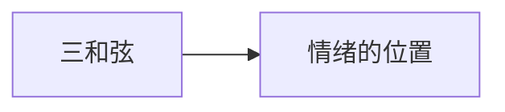

# 第 8 章：我们玩的游戏

- **难度**：★★★ ｜ **预估学时**：0.7 小时 ｜ **前置**：ch07

## 学习目标

- 能说明“感觉—评价—行动”三和弦
- 能解释情绪为何是最早整合的感觉

## 一句话核心

生命体的基本循环是：感知世界、评价对自身有利与否、采取行动；情绪是这三步最早整合成一体的形式。

## 零基础讲解

### 概念 1：三和弦（难度：进阶）

考夫曼借用凯瑟琳·考夫曼的说法：**感觉**（sense）、**评价**（evaluate）、**行动**（act）构成一个循环。没有评价，感觉只是输入；没有行动，评价没有后果。

### 概念 2：情绪的位置（难度：高难）

情绪把“对我有利/有害”直接编码成可行动的状态，比符号推理更早。它是价值判断的原型，不是理性的对立面。

## 图示

看图说明：方框是本章的概念顺序，箭头表示后一个概念必须建立在前一个之上。读图时先确认每个方框你都说得出一句白话定义，再往下看。

## 类比与实例

- **类比**：像开车时的仪表盘：读油量（感觉）、判断够不够（评价）、决定加油（行动）。边界：仪表盘没有情绪，生物有。
- **实例**：遇到捕食者：心率上升（感觉）→ 威胁评估（评价）→ 逃跑（行动）。三步在一个时间窗内耦合，慢一步就死。

## 常见误解

- 别以为情绪是理性的干扰——它是最早的价值计算装置。

## 自测题（答案）

1. “三和弦”不包括？
   - A. 感觉
   - B. 评价
   - C. 行动
   - D. 记忆
   - **答案**：D；**解析**：三和弦是感觉-评价-行动的循环。

## 复习锚点

- 感觉-评价-行动
- 情绪 = 最早的价值整合
- 价值判断先于符号推理
