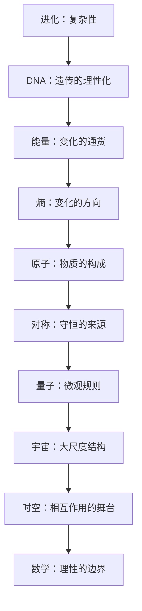

# 伽利略的手指 点化学习系统

## 这本书在讲什么

阿特金斯用十章讲现代科学的十个支柱：进化、DNA、能量、熵、原子、对称、量子、宇宙、时空、数学。写法是从历史困境切入——古人怎么想、卡在哪、谁用什么办法解开——再给出今天的框架。他不求公式完备，而是让你看清每根支柱的位置：进化解释复杂性怎么长出来，DNA 把生物学理性化，能量与熵管变化的方向，原子管物质构成，对称管守恒，量子管微观，宇宙与时空管大尺度，数学管理性的边界。读完应能画出这十者之间的关系，而不是记住十个名词。

## 全书心智模型

## 学习路径（推荐顺序）

| 步骤 | 章节 | 主题 | 前置 | 检查点 |
|---|---|---|---|---|
| 01 | ch01 | 第1章 进化：复杂性的萌芽 | 无 | 完成本章自测 ≥2 题 |
| 02 | ch02 | 第2章 DNA：生物学的理性化 | ch01 | 完成本章自测 ≥2 题 |
| 03 | ch03 | 第3章 能量：计量的普遍化 | 无 | 完成本章自测 ≥2 题 |
| 04 | ch04 | 第4章 熵：变化发生的源泉 | ch03 | 完成本章自测 ≥2 题 |
| 05 | ch05 | 第5章 原子：物质的产生 | ch04 | 完成本章自测 ≥2 题 |
| 06 | ch06 | 第6章 对称：美的量化 | ch05 | 完成本章自测 ≥2 题 |
| 07 | ch07 | 第7章 量子：认识的简化 | ch06 | 完成本章自测 ≥2 题 |
| 08 | ch08 | 第8章 宇宙：真实的纵览 | ch07 | 完成本章自测 ≥2 题 |
| 09 | ch09 | 第9章 时空：互作用的舞台 | ch08 | 完成本章自测 ≥2 题 |
| 10 | ch10 | 第10章 数学：理性的局限 | 无 | 完成本章自测 ≥2 题 |

## 章节索引

- 第 1 章 第1章 进化：复杂性的萌芽（难度 ★）→ chapters/ch01-进化-复杂性的萌芽.md
- 第 2 章 第2章 DNA：生物学的理性化（难度 ★★）→ chapters/ch02-DNA-生物学的理性化.md
- 第 3 章 第3章 能量：计量的普遍化（难度 ★★）→ chapters/ch03-能量-计量的普遍化.md
- 第 4 章 第4章 熵：变化发生的源泉（难度 ★★★）→ chapters/ch04-熵-变化发生的源泉.md
- 第 5 章 第5章 原子：物质的产生（难度 ★★）→ chapters/ch05-原子-物质的产生.md
- 第 6 章 第6章 对称：美的量化（难度 ★★★）→ chapters/ch06-对称-美的量化.md
- 第 7 章 第7章 量子：认识的简化（难度 ★★★）→ chapters/ch07-量子-认识的简化.md
- 第 8 章 第8章 宇宙：真实的纵览（难度 ★★）→ chapters/ch08-宇宙-真实的纵览.md
- 第 9 章 第9章 时空：互作用的舞台（难度 ★★★）→ chapters/ch09-时空-互作用的舞台.md
- 第 10 章 第10章 数学：理性的局限（难度 ★★★）→ chapters/ch10-数学-理性的局限.md

## 前置知识（零基础缺口补讲）

| 缺口 | 对应补讲位置 | 学完标志 |
|---|---|---|
| 自然选择的基本机制 | ch01 概念 1 | 能说出变异、遗传、选择三要素 |
| 热力学第一定律 | ch03 概念 1 | 能说明能量守恒 |
| 元素与周期表 | ch05 概念 1 | 能说出周期表的排列依据 |
| 波与频率 | ch07 概念 1 | 能说明波长与频率的关系 |

## 术语表 / 模式库 / 速查表 入口

- 术语：[glossary.md](glossary.md)
- 模式与框架：[patterns.md](patterns.md)
- 速查：[cheatsheet.md](cheatsheet.md)
- 测验：[quiz.md](quiz.md)
- 抽认卡：[flashcards.md](flashcards.md)

> 单书伴侣：`galileos-finger学习伴侣.html`（双击即可离线学习）
