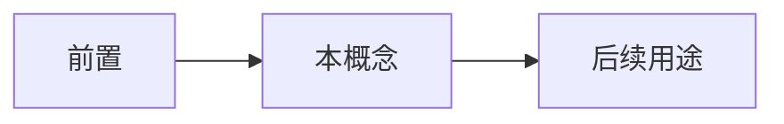

# 能量与熵：一对方向相反的概念

- **难度**：进阶 ｜ **涉及章节**：第 03 章、第 04 章

## 一句话定义

能量管“有多少、怎么转换”，熵管“往哪个方向、还能用多少”。

## 为什么重要

它把“变化”拆成两个独立问题：守恒与方向。缺任一条，热机、生命、宇宙都讲不通。

## 图示

## 详解

能量：封闭系统总量不变，形式可变。

熵：孤立系统不减，可用能减少。

合起来：能量守恒告诉你“不会凭空产生”，熵增告诉你“不能全部回收”。

生命是开放系统：局部降熵，整体增熵。

## 常见误解

- 别以为熵增与能量守恒矛盾——一个管总量，一个管可用性。

## 在书中出现的脉络

| 章节 | 语境 | 关键结论 |
|---|---|---|
| ch03 | 能量 | 守恒 |
| ch04 | 熵 | 方向 |

## 相关概念

- 时间箭头、热机
