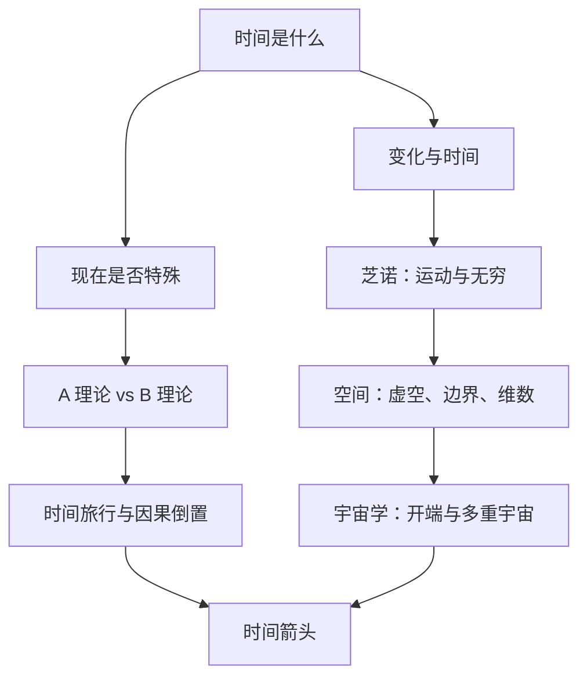

# 四维旅行 点化学习系统

## 这本书在讲什么

这本书不教你算相对论，而是带你走十二个哲学谜题：时间是不是变化、没有变化的时间可不可能、空间有没有边界、无穷过程能否完成、现在是否特殊、运动能不能由静止的瞬间组成、时间旅行会不会自相矛盾、时间箭头从哪来。每一章先把直觉摆出来，再把直觉逼到矛盾，然后给出历史上几种解法，并指出每种解法要付出什么代价。读它的收获不是记住某个答案，而是学会在“看起来显然”的地方停下来问：这个显然，靠得住吗。

## 全书心智模型

## 学习路径（推荐顺序）

| 步骤 | 章节 | 主题 | 前置 | 检查点 |
|---|---|---|---|---|
| 01 | ch01 | 第1章 时间的测量 | 无 | 完成本章自测 ≥2 题 |
| 02 | ch02 | 第2章 变化 | ch01 | 完成本章自测 ≥2 题 |
| 03 | ch03 | 第3章 没边的盒子？ | ch02 | 完成本章自测 ≥2 题 |
| 04 | ch04 | 第4章 曲线和维数 | ch03 | 完成本章自测 ≥2 题 |
| 05 | ch05 | 第5章 时间的开端和结尾 | ch04 | 完成本章自测 ≥2 题 |
| 06 | ch06 | 第6章 空间的边缘 | ch05 | 完成本章自测 ≥2 题 |
| 07 | ch07 | 第7章 无穷和悖论 | ch06 | 完成本章自测 ≥2 题 |
| 08 | ch08 | 第8章 时间会流逝吗？ | ch07 | 完成本章自测 ≥2 题 |
| 09 | ch09 | 第9章 像放电影的宇宙 | ch08 | 完成本章自测 ≥2 题 |
| 10 | ch10 | 第10章 干预历史 | ch09 | 完成本章自测 ≥2 题 |
| 11 | ch11 | 第11章 我们之外的时间和空间 | ch10 | 完成本章自测 ≥2 题 |
| 12 | ch12 | 第12章 时间箭头 | ch11 | 完成本章自测 ≥2 题 |

## 章节索引

- 第 1 章 第1章 时间的测量（难度 ★）→ chapters/ch01-时间的测量.md
- 第 2 章 第2章 变化（难度 ★★）→ chapters/ch02-变化.md
- 第 3 章 第3章 没边的盒子？（难度 ★★）→ chapters/ch03-没边的盒子.md
- 第 4 章 第4章 曲线和维数（难度 ★★）→ chapters/ch04-曲线和维数.md
- 第 5 章 第5章 时间的开端和结尾（难度 ★★★）→ chapters/ch05-时间的开端和结尾.md
- 第 6 章 第6章 空间的边缘（难度 ★★★）→ chapters/ch06-空间的边缘.md
- 第 7 章 第7章 无穷和悖论（难度 ★★★）→ chapters/ch07-无穷和悖论.md
- 第 8 章 第8章 时间会流逝吗？（难度 ★★★）→ chapters/ch08-时间会流逝吗.md
- 第 9 章 第9章 像放电影的宇宙（难度 ★★★）→ chapters/ch09-像放电影的宇宙.md
- 第 10 章 第10章 干预历史（难度 ★★★）→ chapters/ch10-干预历史.md
- 第 11 章 第11章 我们之外的时间和空间（难度 ★★★）→ chapters/ch11-我们之外的时间和空间.md
- 第 12 章 第12章 时间箭头（难度 ★★★）→ chapters/ch12-时间箭头.md

## 前置知识（零基础缺口补讲）

| 缺口 | 对应补讲位置 | 学完标志 |
|---|---|---|
| 速度、距离、时间的基本关系 | ch01 概念 1 | 能说明“用周期运动定义时间” |
| 欧几里得几何的基本公设 | ch04 概念 1 | 能说出“过直线外一点有且仅有一条平行线” |
| 热力学第二定律 | ch12 概念 1 | 能说明熵增与方向 |
| 光速不变与相对论的基本结论 | ch12 概念 2 | 能说明“同时性是相对的” |

## 术语表 / 模式库 / 速查表 入口

- 术语：[glossary.md](glossary.md)
- 模式与框架：[patterns.md](patterns.md)
- 速查：[cheatsheet.md](cheatsheet.md)
- 测验：[quiz.md](quiz.md)
- 抽认卡：[flashcards.md](flashcards.md)

> 单书伴侣：`four-dimensional-travel学习伴侣.html`（双击即可离线学习）
