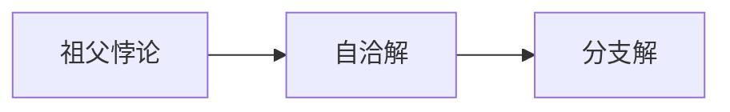

# 第 10 章：干预历史

- **难度**：★★★ ｜ **预估学时**：0.9 小时 ｜ **前置**：ch09

## 学习目标

- 能说明“祖父悖论”的两种解决方向
- 能区分“改变过去”与“自洽的历史”

## 一句话核心

时间旅行若允许改变过去，会产生因果矛盾；两种出路是：过去不可改变（自洽），或存在多条时间线（分支）。

## 零基础讲解

### 概念 1：祖父悖论（难度：进阶）

回到过去杀死祖父，则父亲不会出生，你也不会出生，于是你无法回去杀死祖父。**因果环**（causal loop）让前提自我取消。

### 概念 2：自洽解（难度：高难）

物理上可能只有自洽的历史：你能回去，但任何尝试都会被某种方式阻止，或你的行动本来就是历史的一部分。诺维科夫自洽原则是这一思路的物理版本。

### 概念 3：分支解（难度：高难）

回到过去会分出新时间线，你改变的是另一条线，原线不变。这避免了矛盾，但代价是“改变过去”其实没改变你来自的那条线。

## 图示

看图说明：方框是本章的概念顺序，箭头表示后一个概念必须建立在前一个之上。读图时先确认每个方框你都说得出一句白话定义，再往下看。

## 类比与实例

- **类比**：像录像带：自洽解是带子只能那样放；分支解是每改一次就复制一盘新带。边界：录像带可复制，时间线是否可复制未知。
- **实例**：若你回去阻止一场事故，自洽解会说：你正是事故发生的起因（你的出现触发了它）。这个闭环没有矛盾，但很反直觉。

## 常见误解

- 别以为时间旅行一定自相矛盾——矛盾只出现在“改变过去”的强版本里。

## 自测题（答案）

1. 祖父悖论的“自洽解”主张？
   - A. 过去可随意改
   - B. 只有自洽的历史可能
   - C. 时间不存在
   - D. 多世界
   - **答案**：B；**解析**：任何行动都纳入既定历史，不产生矛盾。

## 复习锚点

- 因果环导致自我取消
- 自洽解：历史只有一种
- 分支解：改的是另一条线
